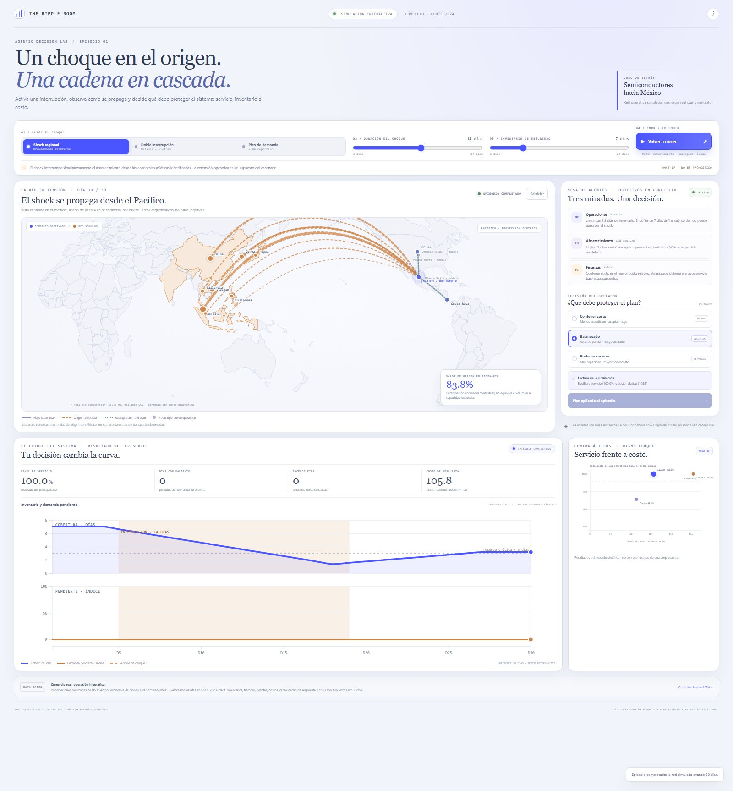

# The Ripple Room · simulador de disrupciones de semiconductores

Simulador de disrupciones en la cadena de suministro de semiconductores: mapa
regional de propagación, dos series alineadas de inventario y demanda, el
trade-off servicio-costo y tres roles simulados —Operaciones, Abastecimiento y
Finanzas— que miran el mismo evento con objetivos distintos.

[](https://github.com/Dev-HugoAguilar/ripple-room-supply-chain/actions/workflows/tests.yml)
[](#demo)
[](#qué-demuestra)

> **Alcance.** La red de empresa, inventarios, demanda, capacidad, costos, rutas y
> crisis son **supuestos de la simulación**. Los únicos datos observados son los
> valores de importación de UN Comtrade/WITS.

---

## Demo

```bash
git clone https://github.com/Dev-HugoAguilar/ripple-room-supply-chain.git
cd ripple-room-supply-chain
python -m http.server 8000 --directory app
```

Abre <http://127.0.0.1:8000/>. Sin compilación ni backend: un único HTML de 0.5 MB
con los datos y la lógica embebidos.



## Qué demuestra

- **Propagación de una disrupción**: cómo un evento en un nodo se propaga por la
  red regional y qué nodos quedan expuestos.
- **Inventario contra demanda**: dos series alineadas en el tiempo, con el
  desfase que introduce la disrupción.
- **Trade-off servicio-costo explícito**: cada decisión muestra qué se gana en
  nivel de servicio y qué cuesta, en lugar de presentar un óptimo único.
- **Tres lecturas del mismo hecho**: los roles simulados priorizan distinto y la
  interfaz no esconde ese desacuerdo.

## Datos

Importaciones de México de **HS 8542** (circuitos integrados electrónicos y
microestructuras), valores nominales en USD reportados por **UN Comtrade** y
presentados por **WITS**, con cortes de 2023 y 2024. Instantánea consultada el
16 de noviembre de 2026. «Other Asia, nes» se conserva como agregado sin punto
geográfico.

## Estructura

```text
app/index.html          Aplicación servible: mapa, series y simulación
source/                 Generador y modelo
  simulation.py         Modelo determinista de la red y las crisis
  extract_world.py      Extrae la base geográfica del mapa
  build_preview.py      Empaqueta la vista previa autocontenida
  data.json             Parámetros de la simulación
  world.geojson         Base geográfica
  requirements.txt
docs/LEEME.md           Documentación original del proyecto
docs/cover.jpg          Captura real de la aplicación servida
```

## Regenerar la demo

```bash
cd source
python -m pip install -r requirements.txt
python build_preview.py
```

## Límites

- Los valores de importación son comercio nominal agregado: no volumen físico,
  proveedores de una empresa, rutas observadas ni capacidad de sustitución.
- La red interna, los escenarios, inventarios, capacidades, costos y respuestas
  de los roles son hipotéticos.
- No hay LLM conectado, inferencia generativa ni aprendizaje automático.
- Los resultados viven en el navegador y no se persisten: no se escriben archivos,
  bases de datos ni sistemas externos.
- La demo no está desplegada públicamente; se sirve de forma local.

## Datos y atribución

**UN Comtrade** a través de **WITS**; base geográfica **Natural Earth**. Detalle en
[`docs/LEEME.md`](docs/LEEME.md). Este repositorio no incluye un archivo `LICENSE`
propio: se respetan las condiciones de las fuentes citadas.

## Seguridad

La demo no ejecuta peticiones de red ni procesa datos personales. Reportes en
[`SECURITY.md`](SECURITY.md); convenciones en [`CONTRIBUTING.md`](CONTRIBUTING.md).
